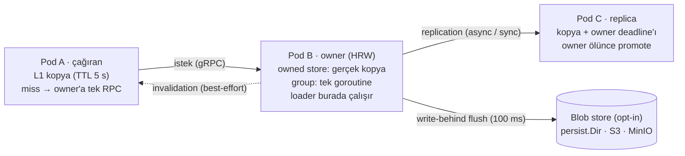

# PeerCache — Kullanım Kılavuzu ve Use Case'ler

PeerCache v1.0.0 için · 2026-11-16 · İngilizce referans: [`docs/api.md`](api.md)

## Genel bakış

PeerCache, Go servisinin içine gömülen, partition'lanmış ve paylaşılan bir in-memory state katmanıdır. Ayrı bir cache tier'ı (Redis, Memcached) yoktur: servisin her pod'u kütüphaneyi çalıştırır ve state'i birlikte tutarlar. Sürüm `v1.0.0` (2026-11-16), modül `github.com/arwenizEr/peercache`, Go 1.25+.

Çözdüğü problem: sık okunan, paylaşılan ve yeniden üretilebilir state için her erişimde ağa çıkma maliyeti. PeerCache'te her key'in tek bir owner pod'u vardır. Okuma owner'daysa ya da yakın zamanda L1'e alınmışsa yerel bellekten gelir. Değilse tek bir gRPC çağrısıyla owner'dan gelir. Yazmalar ve kayıtlı fonksiyonlar owner'da çalışır: veri çağırana taşınmaz, hesaplama veriye taşınır.



Çağıran pod L1'den okur ya da owner'a tek RPC atar. Owner yazar, replica'ya kopyalar ve persistence açıksa blob store'a flush eder. Invalidation kesik çizgidir: kaybolabilir, doğruluk ona bağlı değildir.

Beş ana parça:

- **Ownership** — rendezvous (HRW) hashing, canlı üyelik üzerinden. Üyelik değişince yalnızca etkilenen key'ler taşınır.
- **Namespace** — key/value alanı. Her namespace kendi replication factor'ü, loader'ı, persistence'ı ve TTL kurallarıyla açılır.
- **Group** — virtual actor. Owner'da tek goroutine'de çalışır, bu yüzden lock API'si yoktur.
- **Replication** — kopyalar diğer pod'larda tutulur, varsayılan async, istenirse sync.
- **Persistence** — opt-in, namespace başına. Blob store'a (disk, paylaşılan volume, S3) write-behind.

Ne değildir: veritabanı değildir, transaction yoktur (iki key ya da iki group'u kapsayan hiçbir işlem yok), pub/sub, stream ya da scripting sunmaz, tek Kubernetes cluster'ı = tek failure domain kapsamındadır. Ayrıntı: [Anti-pattern'ler](#anti-patternler-ve-kullanmaman-gereken-yerler).

## Temel kavramlar

Her şey şu zincire dayanır: **key → (partitioner) → group → (HRW) → owner pod**. Ownership key başına değil group başınadır. Varsayılan `PartitionByKey()` her key'i kendi group'u yapar. Bir partitioner birden çok key'i tek group'a toplayabilir; o zaman hepsi aynı owner'da, aynı goroutine'de yaşar.

| Kavram | Ne | Neden önemli |
| --- | --- | --- |
| Owner | Group'u HRW sıralamasında en üste koyan pod | Tüm yazmalar ve group fonksiyonları burada çalışır. Bir pod gidince yalnızca onun key'leri taşınır. |
| Namespace | Ayrı ayarlarla açılan key alanı (`Namespace` byte API, `NamespaceOf[T]` typed) | Seçenekler ilk açılışta sabitlenir, sonradan değişmez. Her pod'da aynı seçeneklerle açılmalı. |
| Group (virtual actor) | Her zaman adreslenebilir, owner'da ilk çağrıda aktive olan, idle olunca deaktive olan birim | Aktif group tek goroutine + bounded mailbox ile çalışır. Çağrılar asla çakışmaz, lock gerekmez. |
| Owned store | Owner'ın kendi key'lerini tuttuğu sharded store | Gerçeğin tek kaynağı. TTL ve versiyon burada. |
| L1 | Owner olmayan pod'un tuttuğu kısa ömürlü kopya (varsayılan `WithL1TTL` 5s, `WithL1MaxBytes` 64 MiB) | Uzak okumayı yerel yapar. Bayatlık üst sınırı L1 TTL'dir; invalidation mesajı yalnızca hızlandırır. |
| Replica | Başka pod'larda tutulan kopya (RF 1–3) | Owner ölünce bir replica promote edilir. Async varsayılan, `WithSyncReplication` ile sync. |
| Epoch | Her üyelik görünümünün numarası | Eski görünümle gelen istekler reddedilir ve sayılır (`StaleEpochRefusals`). Çift aktivasyon böyle tespit edilir. |
| Activation delay | Yeni edinilen group'ların aktivasyonunu erteleyen süre (varsayılan 3s) | Önceki owner'ın kaybettiğini fark etmesine zaman tanır. Bu sürede çağrılar `ErrActivationPending` alır. |
| Registered function | Başlangıçta isimle kaydedilen fonksiyon ya da loader | Closure ağdan geçmez; RPC `(isim, []byte args)` taşır. Tüm pod'lar aynı binary'yi çalıştırmalı. |
| Persistence | Namespace başına opt-in blob store yazımı | Aynı key'in tüm sahipleri ölse bile veri döner. Kayıp penceresi = flush aralığı. |

**Bir okuma nasıl yol alır:** (1) pod key'in owner'ı mı? Evet → owned store'dan. (2) Değilse L1'de geçerli kopya var mı? Evet → L1'den. (3) Yoksa owner'a tek RPC. Aynı key'i aynı anda isteyen çağıranlar tek RPC'de birleştirilir (coalescing, her zaman açık). (4) Owner'da da yoksa ve loader varsa, loader owner'da bir kez çalışır.

**Bir yazma nasıl yol alır:** owner'a gider, owned store'a yazılır, versiyon damgalanır, replica'lara gönderilir (async: hemen ack; sync: replica'lar onaylayınca ack), persistence açıksa sonraki flush'a eklenir, diğer pod'lara best-effort L1 invalidation yayını yapılır.

## Kurulum ve tek node quick start

Tek node için yalnızca bir node ID yeter. Aynı kod cluster'da değişmeden çalışır; yalnızca `peercache.New` çağrısına transport ve membership eklenir.

```bash
go get github.com/arwenizEr/peercache
```

```go
package main

import (
	"context"
	"errors"
	"fmt"
	"log"
	"time"

	"github.com/arwenizEr/peercache"
)

type Session struct {
	UserID string
	Cart   []string
}

func main() {
	ctx := context.Background()

	cache, err := peercache.New(peercache.WithNodeID("pod-0"))
	if err != nil {
		log.Fatal(err)
	}
	defer cache.Close(ctx)

	// Typed namespace: değerler msgpack ile kodlanır (WithCodec("json") ile json).
	sessions := peercache.NamespaceOf[Session](cache, "sessions",
		peercache.WithReplicationFactor(2))

	if err := sessions.Set(ctx, "s:123", Session{UserID: "u1", Cart: []string{"book"}}, 30*time.Minute); err != nil {
		log.Fatal(err)
	}

	s, err := sessions.Get(ctx, "s:123")
	switch {
	case errors.Is(err, peercache.ErrNotFound):
		fmt.Println("yok")
	case err != nil:
		log.Fatal(err)
	default:
		fmt.Println(s.UserID, s.Cart)
	}
}
```

Önemli kurallar, daha ilk satırdan:

- **Namespace'leri başlangıçta aç.** `Namespace` hata döndürmez; geçersiz bir seçenek o handle üzerindeki her işlemde hata olarak döner. Aynı isimle ikinci çağrı aynı handle'ı döndürür; ilk çağrının seçenekleri kazanır, farklı seçenekler bir kez Warn log'lanır.
- **TTL `0`** süresiz demektir. TTL owner'da mutlak deadline olarak tutulur ve failover'da korunur.
- **Hatalar** `errors.Is` ile eşleştirilir: `ErrNotFound`, `ErrActivationPending`, `ErrUnderReplicated`, `ErrNoLoader`, `ErrInvalidOption` vb. hepsi kök pakettedir.
- **`context`** deadline'ı RPC sınırını ve group yürütümünü geçer. `nil` context her API sınırında reddedilir.
- **Byte API** — kendi encoding'ini getiren için `cache.Namespace("name")` aynı API'yi `[]byte` üzerinden sunar.

## Cluster kurulumu ve Kubernetes

Cluster için iki parça daha gerekir: peer transport (`transport`, gRPC, port **7947**) ve membership (`membership`, memberlist üzerinden gossip, port **7946**). İki ayrı sokettir; karıştırılırsa peer'lar memberlist'e gRPC ile bağlanır ve `error reading server preface: EOF` alır.

```go
self := peercache.Node{ID: os.Getenv("NODE_ID"), Addr: os.Getenv("DATA_ADDR")}

l, err := net.Listen("tcp", self.Addr) // cache'ler arası gRPC
if err != nil {
	return err
}
tr, err := transport.New(transport.Options{Self: self}) // TLS: transport.Options.TLS ile mTLS
if err != nil {
	return err
}
gossip, err := membership.New(membership.Options{
	Self:     self,
	BindAddr: os.Getenv("GOSSIP_ADDR"),
})
if err != nil {
	return err
}

cache, err := peercache.New(
	peercache.WithNodeID(self.ID),
	peercache.WithTransport(tr),
	peercache.WithListener(l),
	peercache.WithMembership(gossip),
	peercache.WithSeeds(seeds...),               // headless service'ten çözülen gossip adresleri
	peercache.WithActivationDelay(3*time.Second),
	peercache.WithCatchUpGate(),                 // forward edilen yazmaları catch-up bitene kadar tut
)
if err != nil {
	return err
}
```

### Başlangıç sırası (değiştirilemez)

1. Blob store'u (persistence varsa) oluştur.
2. **Tüm namespace'leri** aynı seçeneklerle aç, **tüm group fonksiyonlarını ve loader'ları** kaydet. Cluster'a katılmadan önce. Açılmamış bir namespace için gelen peer isteği `ErrActivationPending` ile reddedilir ve `UnopenedNamespaceRefusals` sayılır (v1.0.0'dan önce default seçeneklerle, RF=1 ve persistence'siz yaratılıyordu; kind'da bu yüzden bir pod'un tüm sipariş payı kayboldu).
3. `cache.CatchUp(ctx)` — bu node'un tutması gereken replica'ları peer'lardan çeker. `WithCatchUpRate(n)` ile saniyede n entry ile sınırlanabilir (20.000/s ≈ 1M key bir dakikanın altında).
4. `cache.WaitReady(ctx)` — `Ready()` true olana kadar bekler.
5. Trafik al.
6. Kapanışta PreStop: `cache.Drain(ctx)`, sonra `cache.Close(ctx)`.

### Readiness

`cache.Ready()` bir `ReadyState` döner: `Ready`, `Joined` (üyelik öğrenildi), `Settled`, `CaughtUp`, `ReplicasCurrent`, `Draining`, `Reason`. Readiness probe `Ready`'yi okur. `CatchUp` çalışmadan `Ready` false kalır. Neden: yeni katılan node anında owner olur ama hiçbir şey tutmaz, catch-up olmadan başka node'da güvenle duran veri için emin bir şekilde "not found" der.

`ReplicasCurrent` ayrı bir sinyaldir (`peercache_replicas_current`): bu node mevcut görünüm altında catch-up yaptı mı? Readiness'in içinde değil, çünkü node replication factor geri gelmeden çok önce doğru hizmet verebilir.

### Drain

`Drain` sırasıyla: unready işaretler, ayrılışı duyurur, sahip olduğu key'leri yeni owner'lara iter, group'ları deaktive eder. Idempotenttir ve `Close` değildir: drain edilmiş cache henüz fark etmemiş peer'lara cevap vermeye devam eder. RF≥2'de hand-off çoğunlukla latency optimizasyonu; RF=1'de graceful shutdown ile tüm payı kaybetmek arasındaki tek şey.

### Deployment mi StatefulSet mi

|  | `deploy/deployment.yaml` | `deploy/statefulset.yaml` |
| --- | --- | --- |
| Pod kimliği | Rastgele, her restart'ta değişir | Sabit: `app-0`, `app-1`, … |
| Restart sonrası ownership | Yeni node sayılır, pay iki kez dağıtılır | Aynı payı geri alır |
| Ne zaman | Namespace loader'dan yeniden kurulabiliyorsa | Payı kaybedip yeniden kazanmak pahalıysa, keyspace büyükse |

### Kubernetes kontrol listesi

- [ ] Headless service (`clusterIP: None`), `SEEDS` = service adı. DNS her pod'un adresini dönmeli.
- [ ] 7946 (gossip) ve 7947 (gRPC) ayrı portlar.
- [ ] `readinessProbe` → `GET /readyz` → `cache.Ready()`.
- [ ] `preStop` → `POST /drain` → `cache.Drain(ctx)`; `terminationGracePeriodSeconds` drain süresinden uzun (manifestte 60).
- [ ] Rolling update: `maxUnavailable: 1` ve catch-up'ın bitmesine yetecek `minReadySeconds`. Bir sonraki pod'u değiştirmeden önce tüm pod'larda `peercache_replicas_current` = 1 olsun; yoksa RF=3 rollout kısa süre RF=1'e düşer.
- [ ] Memory limit: steady state + bir peer ölünce devralınacak replica'lar için pay. Steady state'e göre boyutlanan pod ilk failover'da OOM olur. Ya da `WithMemoryBudget`.
- [ ] CPU: limit yok ya da cömert limit. Throttle olan pod geç cevap verir, memberlist 500 ms probe timeout ile bunu ölüm sanabilir. `GOMAXPROCS`'u elle ayarlama.

## Use case 1: Session store

Oturum verisi PeerCache için en doğal iş: sık okunur, kısa ömürlüdür ve kaybolursa kullanıcı yeniden giriş yapar. Redis hop'u kalkar; session sahibi pod'da okuma yerel bellektir, diğer pod'larda L1 kopyası 5 s boyunca yereldir.

**Önerilen kurulum:** typed namespace, RF=2, sliding expiration için `Touch`, toplu expire spike'ını dağıtmak için TTL jitter.

```go
type Session struct {
	UserID    string
	Roles     []string
	Cart      []string
	CreatedAt time.Time
}

sessions := peercache.NamespaceOf[Session](cache, "sessions",
	peercache.WithReplicationFactor(2), // owner ölürse replica promote edilir
	peercache.WithTTLJitter(0.1),       // TTL'ler %10'a kadar kısaltılır, birlikte expire olmaz
	peercache.WithL1TTL(2*time.Second), // logout'un başka pod'larda en geç 2 s'de görülmesi
)

// Login
func login(ctx context.Context, id string, u User) error {
	return sessions.Set(ctx, "s:"+id, Session{UserID: u.ID, Roles: u.Roles, CreatedAt: time.Now()}, 30*time.Minute)
}

// Her istekte: oku ve süreyi uzat
func authenticate(ctx context.Context, id string) (Session, error) {
	s, err := sessions.Get(ctx, "s:"+id)
	if err != nil {
		return Session{}, err // errors.Is(err, peercache.ErrNotFound) → 401
	}
	// Touch güvenle tekrarlanabilir tek atomic işlem.
	if _, err := sessions.Touch(ctx, "s:"+id, 30*time.Minute); err != nil {
		return Session{}, err
	}
	return s, nil
}

// Logout
func logout(ctx context.Context, id string) error {
	return sessions.Delete(ctx, "s:"+id)
}
```

**Dikkat edilecekler**

- **Logout gecikmesi = L1 TTL.** Silme owner'da anında, invalidation yayını da gider; ama yayın kaybolursa başka pod'daki L1 kopyası TTL dolana kadar okunabilir. Güvenlik açısından kritik iptal için L1 TTL'i kısa tut (1–2 s). Bir kopya key'in kendisinden uzun yaşamaz: session owner'da expire olunca her yerde aynı anda gider.
- **Her istekte `Touch` bir yazmadır** (owner'a gider, replica'lara yayılır). Yüksek trafikte her N istekte bir ya da TTL'in yarısı geçtiyse touch et.
- **Kayıp tolere edilir mi?** Async RF=2'de owner ölürse son ~0,1 ms içindeki yazmalar kaybolabilir; kullanıcı en kötü ihtimalle yeniden giriş yapar. Kabul edilemezse `WithSyncReplication()`.
- **Sepet gibi değerli veri** session içindeyse ve kaybolmamalıysa ya ayrı bir persistent namespace'e taşı ya da session namespace'ine `WithPersistence` ekle.
- **Session'a bağlı sayacı güncellemek** gibi okuma-değiştirme-yazma işleri için `Get` + `Set` yerine group fonksiyonu kullan (Use case 4); `TypedNamespace` üzerinde `CompareAndSwap` yok.

## Use case 2: Rate limiting

Sayaç owner'da tek adımda artar, yani tüm pod'lar aynı sayacı görür ve yarış yoktur. Redis `INCR` + `EXPIRE` çiftinin yerini `Increment` tek başına alır: TTL ilk vuruşla başlar ve sonraki artışlarla uzamaz.

### Sabit pencere (fixed window)

```go
limits := cache.Namespace("ratelimit") // RF=1 yeterli: kaybolursa pencere sıfırlanır

func allow(ctx context.Context, user string, limit int64) (bool, error) {
	minute := time.Now().UTC().Format("200601021504")
	hits, err := limits.Increment(ctx, "rl:"+user+":"+minute, 1, time.Minute)
	if err != nil {
		return true, err // fail-open ya da fail-closed: uygulamanın kararı
	}
	return hits <= limit, nil
}
```

Eksik key sıfır sayılır. Değer base-10 metin olarak tutulur, `Get` ile okunur, `Set` ile başlatılabilir. Tamsayı olmayan değer ya da `int64` taşması `ErrNotAnInteger` döner ve hiçbir şeyi değiştirmez.

### Token bucket ya da sliding window (group fonksiyonu)

Birden çok değeri birlikte okuyup yazan algoritmalar group içinde çalışır; group tek goroutine olduğu için işlem doğal olarak atomiktir.

```go
type take struct {
	Rate  float64 // saniyede token
	Burst float64
	NowMs int64   // çağıran gönderir; fonksiyon deterministik kalır
}

err := peercache.RegisterTypedGroupFunc(cache, "bucket.take",
	func(ctx context.Context, s peercache.GroupState, a take) (bool, error) {
		tokens, last := a.Burst, a.NowMs
		if b, ok := s.Get("tokens"); ok {
			tokens, _ = strconv.ParseFloat(string(b), 64)
		}
		if b, ok := s.Get("last"); ok {
			last, _ = strconv.ParseInt(string(b), 10, 64)
		}
		tokens = math.Min(a.Burst, tokens+float64(a.NowMs-last)/1000*a.Rate)
		ok := tokens >= 1
		if ok {
			tokens--
		}
		s.Set("tokens", []byte(strconv.FormatFloat(tokens, 'f', -1, 64)))
		s.Set("last", []byte(strconv.FormatInt(a.NowMs, 10)))
		return ok, nil
	})

allowed, err := peercache.CallTyped[take, bool](ctx, cache.Group("bucket:"+apiKey), "bucket.take",
	take{Rate: 10, Burst: 20, NowMs: time.Now().UnixMilli()})
```

**Dikkat edilecekler**

- **`Increment`'i körü körüne tekrarlama.** Cache `ErrNotOwner`, `ErrStaleEpoch`, `ErrActivationPending` sonrası owner'ı bir kez kendisi yeniden çözer; bunlar hiçbir şey uygulanmadan döner. `ErrNodeUnreachable` ya da deadline sonrası owner işlemi uygulamış olabilir; tekrar iki kez sayar. Rate limit için bu genelde kabul edilebilir (kullanıcı aleyhine fazla sayar), faturalandırma sayacı için değil (Use case 9).
- **Partition sırasında limit iki katına çıkabilir.** İki aktivasyon iki tarafta da artış kabul edebilir; replica bunu split-brain olarak sayar, toplamaz. Limit yaklaşık bir koruma, sert kota değil.
- **Hot key:** tek bir çok popüler API key'in sayacı tek pod'un throughput'uyla sınırlıdır. Çok yüksek oranlarda key'i shard'la (`rl:user:7:shard-3`) ve limiti böl.
- **Group fonksiyonunda `time.Now()` çağırma**; zamanı argüman olarak geçir, fonksiyon test edilebilir ve deterministik kalır.

**Token bucket'ın state'i group state'idir ve replicate edilmez.** Owner değişince (restart, scale, drain) yeni owner boş state'le başlar ve bucket tam dolu (`Burst`) açılır. Rate limit için genelde kabul edilebilir; değilse sabit pencereyi `Increment` ile RF=2 namespace'te tut (shop örneği böyle yapıyor).

## Use case 3: Read-through cache (veritabanının önünde)

Kullanıcı profili, ürün kataloğu, fiyat, konfigürasyon gibi asıl kaynağı bir veritabanı olan veri için loader'lı namespace kullan. Miss, çağıranda değil key'in owner'ında yüklenir. Aynı key için 1000 eş zamanlı miss loader'ı tam bir kez çağırır, diğer 999 çağrı o yüklemeye bağlanır. Bu cluster genelinde geçerlidir: farklı pod'lardan gelen miss'ler de aynı owner'da birleşir.

### Temel: tek key loader

```go
profiles := peercache.NamespaceOf[Profile](cache, "profiles",
	peercache.WithTypedLoader(func(ctx context.Context, key string) (Profile, time.Duration, error) {
		p, err := db.LoadProfile(ctx, key)
		if errors.Is(err, sql.ErrNoRows) {
			return Profile{}, 0, peercache.ErrNotFound // negatif cache bunu hatırlar
		}
		return p, 10 * time.Minute, err
	}),
	peercache.WithLoaderTimeout(2*time.Second),     // varsayılan 30s
	peercache.WithNegativeCaching(30*time.Second),  // olmayan key'leri DB'ye her seferinde sorma
	peercache.WithRefreshAhead(time.Minute),        // sıcak key'leri expire olmadan yenile
	peercache.WithTTLJitter(0.1),                   // aynı anda yüklenenler aynı anda expire olmasın
)

p, err := profiles.GetOrLoad(ctx, "user:123")
```

Yazma yolunda (profil güncellendiğinde) iki seçenek var: yeni değeri `Set` ile yaz (write-through) ya da `Delete` ile sil, sonraki `GetOrLoad` yeniden yüklesin (invalidate). `Delete` aynı zamanda negatif kaydı da unutturur; yeni yaratılan bir satır için doğru çağrı budur.

### Toplu yükleme: `BatchGetOrLoad`

Bir sayfa 50 ürün gösteriyorsa 50 ayrı sorgu yerine owner başına bir istek ve bir sorgu:

```go
products := cache.Namespace("products",
	peercache.WithBatchLoader(func(ctx context.Context, keys []string) (map[string][]byte, time.Duration, error) {
		return db.LoadProducts(ctx, keys) // SELECT ... WHERE id IN (...)
	}),
)
page, err := products.BatchGetOrLoad(ctx, ids) // üç owner = üç istek, üç sorgu
```

- Loader'ın map'inde olmayan key yok sayılır ve sonuçtan çıkarılır.
- Bir çağrının döndürdüğü tüm değerlere tek TTL uygulanır.
- Hata veren owner'ın key'leri eksik gelir, hatası dönen hataya join edilir; diğer owner'ların key'leri yine döner. Key'ler arası atomiklik yoktur.
- `WithBatchLoader` yoksa her eksik key için `WithLoader` çalışır: round-trip'ler kazanılır, sorgular kazanılmaz.

### Davranış kuralları

| Kural | Neden |
| --- | --- |
| Loader çağıranın context'ini miras almaz, `WithLoaderTimeout` deadline'ıyla çalışır | 5 ms'si kalan ilk çağıran, 1 s'si kalan 999 çağıranın beklediği yüklemeyi iptal edemesin |
| Context'i biten çağıran beklemeyi bırakır, yükleme diğerleri için sürer | Tek bir sabırsız çağıran herkesi cezalandırmasın |
| Panic yapan loader tüm bekleyenlere `ErrLoaderPanic` olur | Loader uygulama kodudur; bin goroutine'de panic olmaz |
| Loader çalışırken gelen yazma kazanır | Loader eski veriyi okumuş olabilir |
| Negatif cache yalnızca `ErrNotFound`'u hatırlar | DB kesintisi asla "not found" olarak servis edilmez |
| Negatif kayıtlar owner-local, shard başına en fazla 256, replicate edilmez | Sınırlı bellek; en kötü durumda bir fazla sorgu, asla yanlış cevap |
| Refresh-ahead yalnızca owner'da ve yalnızca `GetOrLoad` ile çalışır | `Get` asla yüklemez; son pencerede kimsenin okumadığı key normal expire olur |
| Başarısız refresh eski değeri kendi expire'ına kadar tutar | Yanlış anda DB restart'ı en sıcak key'leri boşaltmasın (`Stats().RefreshFailures`) |

**Neden replication şart değil:** veri DB'de duruyor. RF=1 ile owner ölünce key'ler yeni owner'da loader'dan tekrar yüklenir; tek bedel DB'ye bir dalga sorgudur. DB bu dalgayı kaldıramayacaksa RF=2 kullan, failover sıcak kalsın.

## Use case 4: Tenant başına aggregate (group fonksiyonları)

Bir tenant'ın, kullanıcının ya da hesabın üzerinde sürekli güncellenen bir özet (sepet, kullanım sayacı, son N olay, skor) için group kullan. Hesaplama owner'a gider; veri asla çağırana taşınmaz. Tek group turu yaklaşık 1,2 µs sürer.

```go
type usage struct {
	Events int64
	Bytes  int64
}

// Başlangıçta, her pod'da, aynı isimle.
err := peercache.RegisterTypedGroupFunc(cache, "usage.add",
	func(ctx context.Context, s peercache.GroupState, n int64) (usage, error) {
		u := usage{}
		if b, ok := s.Get("events"); ok {
			u.Events, _ = strconv.ParseInt(string(b), 10, 64)
		}
		if b, ok := s.Get("bytes"); ok {
			u.Bytes, _ = strconv.ParseInt(string(b), 10, 64)
		}
		u.Events++
		u.Bytes += n
		s.Set("events", []byte(strconv.FormatInt(u.Events, 10)))
		s.Set("bytes", []byte(strconv.FormatInt(u.Bytes, 10)))
		return u, nil
	})

// Herhangi bir pod'dan: "tenant:acme"'nin owner'ında çalışır.
u, err := peercache.CallTyped[int64, usage](ctx, cache.Group("tenant:acme"), "usage.add", 4096)
```

### Ne zaman group, ne zaman namespace

| İhtiyaç | Kullan |
| --- | --- |
| Tek key'i atomik değiştirmek (sayaç, ilk yazan kazanır, CAS) | Namespace atomic işlemleri: `Increment`, `SetIfAbsent`, `CompareAndSwap`, `Touch` |
| Birden çok değeri okuyup birlikte güncellemek | Group fonksiyonu |
| Owner üzerinde büyük bir set üzerinde hesaplama | Group fonksiyonu (`Items` ile veri taşıma) |
| Pod kaybını ve owner değişimini atlatması gereken veri | Namespace (RF≥2, gerekirse persistence) |
| Zamanlayıcıyla tetiklenen iş (timeout, hatırlatma) | Group + `ScheduleTimer` (Use case 5) |

### Group state'in sınırları (mutlaka oku)

- **Group state replicate edilmez ve persist edilmez.** Design §5 bunu v1 için bilerek erteledi. Owner değişince (pod ölümü, restart, scale-out, drain) yeni owner kendi boş kaydıyla başlar. Eski owner'daki state artık servis edilmez (`ErrNotOwner`), yanlış node'dan okunmaz ama kaybolmuş olur (open.md q51).
- **Kalıcı olması gerekeni namespace'e yaz.** Kayıtlı fonksiyon yerel bir closure'dır; başlangıçta açtığın namespace handle'ını yakalayabilir. Namespace işlemleri group mailbox'ından geçmez. Namespace'i `PartitionByPrefix("/")` ile açarsan `tenant:acme/usage` key'inin group key'i `tenant:acme` olur ve group ile aynı owner'a düşer, yazma yereldir. Bu yine de iki ayrı işlemdir: group state + namespace yazımı arasında atomiklik yoktur.
- **`GroupState` yalnızca o tur için geçerlidir.** Bir goroutine'e yakalayıp sonra kullanmak hiçbir şey yapmaz ve `Stats().StateEscapes` sayar.
- **Group entry'lerinin bağımsız TTL'i yoktur**; group kaydı yaşadıkça yaşarlar. Temizlemeyi kendin yap (`Delete` ya da timer).
- **Backpressure:** mailbox (varsayılan 64, `WithGroupMailboxSize`) doluysa `ErrGroupOverloaded` anında döner. Tekrarlanabilir bir hatadır ve tekrar beklenen davranıştır: 64'lük mailbox'a 1000 eş zamanlı çağıran yine tam doğru toplamı üretir.
- **Maliyet:** adreslenebilir group ≈167 B, aktif group ≈1,1 KiB heap + goroutine stack. Bir milyon adreslenebilir group ≈160 MiB. `WithMaxActiveGroups` ve `WithGroupIdleTimeout` aktif sayıyı sınırlar; deaktivasyon state'i ve timer'ları korur.
- **Rolling upgrade:** yeni sürümde eklenen bir fonksiyonu eski pod çağırdığında `ErrFuncNotRegistered` alır. Bu beklenen bir durumdur; önce fonksiyonu tüm pod'lara dağıt, sonra çağırmaya başla.
- **Fonksiyon içinde panic** çağırana `ErrGroupFuncPanic` olarak döner.

## Use case 5: Workflow / state machine

Bir siparişin, ödeme oturumunun, onay sürecinin ya da bir oyun odasının durumu group içinde tutulduğunda her geçiş tek goroutine'de, sırayla uygulanır. İki eş zamanlı "onayla" ve "iptal" çakışamaz. `ScheduleTimer` ile timeout'lar group'un içinde yaşar.

```go
// Durumlar: pending -> paid -> shipped, ya da pending -> expired
err := cache.RegisterGroupFunc("pay.start", func(ctx context.Context, s peercache.GroupState, arg []byte) ([]byte, error) {
	if _, ok := s.Get("state"); ok {
		return nil, errors.New("already started")
	}
	s.Set("state", []byte("pending"))
	// 15 dakika içinde ödeme gelmezse "pay.expire" bu group'ta çalışır.
	s.ScheduleTimer("expire", 15*time.Minute, "pay.expire", nil)
	return nil, nil
})

err = cache.RegisterGroupFunc("pay.confirm", func(ctx context.Context, s peercache.GroupState, arg []byte) ([]byte, error) {
	st, _ := s.Get("state")
	if string(st) != "pending" {
		return st, nil // tekrar gelen onay: idempotent cevap
	}
	s.Set("state", []byte("paid"))
	s.CancelTimer("expire")
	return []byte("paid"), nil
})

err = cache.RegisterGroupFunc("pay.expire", func(ctx context.Context, s peercache.GroupState, arg []byte) ([]byte, error) {
	if st, _ := s.Get("state"); string(st) == "pending" {
		s.Set("state", []byte("expired"))
	}
	return nil, nil
})

// Herhangi bir pod'dan:
_, err = cache.Group("payment:"+id).Call(ctx, "pay.start", nil)
_, err = cache.Group("payment:"+id).Call(ctx, "pay.confirm", nil)
```

**Bu desen ne sağlar:** geçişler serialize edilir (tek aktivasyon olduğu sürece), timer'lar deaktivasyonda korunur, bekleyen timer'ı olan group idle deaktivasyondan muaftır. `WithMaxActiveGroups` tavanı yine de onu çıkarabilir; o zaman timer'lar bir sonraki çağrıya kadar uyur.

**Bu desen ne sağlamaz:**

- **Owner değişiminde state ve timer'lar kaybolur.** Group state replicate edilmez. Pod restart'ı, scale-out ya da drain sonrası yeni owner boş başlar ve `pay.expire` hiç çalışmaz. Kaybolması kabul edilemeyen workflow için durumun asıl kopyasını namespace'te tut.
- **Partition sırasında iki aktivasyon** oluşabilir; iki taraf da geçiş kabul edebilir. Epoch ile tespit edilir, birleştirilmez.

### Dayanıklı varyant: durumu namespace'te CAS ile ilerlet

Kaybolmaması gereken bir state machine için durumu RF=3, sync replication ve persistence'lı bir namespace'te tut ve her geçişi `CompareAndSwap` ile yap. Bu bir geçişi yalnızca beklenen önceki durumdan izin verir:

```go
flows := cache.Namespace("payments",
	peercache.WithReplicationFactor(3),
	peercache.WithSyncReplication(),
	peercache.WithPersistence(store, persist.WithFlushInterval(time.Second)),
)

func transition(ctx context.Context, id, from, to string) (bool, error) {
	return flows.CompareAndSwap(ctx, "pay:"+id, []byte(from), []byte(to), 0)
}

created, err := flows.SetIfAbsent(ctx, "pay:"+id, []byte("pending"), 0)
ok, err := transition(ctx, id, "pending", "paid") // ikinci onay false döner
```

Timeout'lar bu varyantta dışarıdan tetiklenir: gecikmeli bir kuyruk mesajı ya da deadline'ı tutan asıl sistem (DB, iş kuyruğu). Namespace'in key tarama API'si yoktur, bu yüzden `pending` kayıtları PeerCache içinden bulunamaz. Group timer'ı yalnızca hızlandırıcı olarak eklenebilir. `CompareAndSwap` geçişi idempotent yapar: ikinci bir `pending → paid` false döner, durum bozulmaz. `CompareAndSwap` byte API'dedir, `TypedNamespace` üzerinde yoktur.

## Use case 6: Kuyruk mesajlarını owner'a yönlendirme (Router)

Kafka, SQS ya da NATS tüketen bir servis her pod'da rastgele mesaj alır, ama mesajın etkilediği state (tenant, hesap, cihaz) tek bir owner'dadır. `NewRouter` mesajları owning group'a göre gruplar, owner başına **bir** istek atar ve owner bir group'un tüm mesajlarını tek actor turunda uygular. 10.000 mesaj üç owner'a dağılıyorsa flush başına en fazla üç istek gider.

```go
type Event struct {
	ID       string
	TenantID string
	Amount   int64
}

// Handler: owner'da, bir group'un o flush'taki tüm mesajları için tek turda çalışır.
// Argüman tek mesaj değil, encode edilmiş batch'tir; peercache.Batch çözer
// ve gönderim sırasını korur.
err := cache.RegisterGroupFunc("events.apply", func(ctx context.Context, s peercache.GroupState, arg []byte) ([]byte, error) {
	events, err := peercache.Batch[Event](arg)
	if err != nil {
		return nil, err
	}
	total := int64(0)
	if b, ok := s.Get("total"); ok {
		total, _ = strconv.ParseInt(string(b), 10, 64)
	}
	for _, e := range events {
		if _, seen := s.Get("seen:" + e.ID); seen {
			continue // tekrar teslimat: atla
		}
		s.Set("seen:"+e.ID, nil) // üretimde sınırlı bir pencere tut, sonsuza kadar biriktirme
		total += e.Amount
	}
	s.Set("total", []byte(strconv.FormatInt(total, 10)))
	return nil, nil
})

// groupOf saf ve tüm pod'larda aynı olmalı, tıpkı bir Partitioner gibi.
router := peercache.NewRouter(cache, func(e Event) string { return "tenant:" + e.TenantID }, "events.apply")

for batch := range consumer.Batches() {
	if err := router.Submit(ctx, batch.Events...); err != nil {
		// owner'lar arası atomiklik ve rollback yok: bazı group'lar uygulanmış olabilir
		batch.Nack()
		continue
	}
	batch.Ack()
}
```

**Kurallar ve uyarılar**

- **Owner'lar arası atomiklik yoktur.** `Submit` hata dönerse bazı owner'lar uygulamış, bazıları uygulamamış olabilir. Tekrar teslimat (at-least-once) varsa handler idempotent olmalı: group state'inde son işlenen offset'i ya da mesaj ID'lerini tut ve tekrarı atla.
- **Boş `Submit`** başarılıdır.
- **Handler group fonksiyonudur**; Use case 4'teki group state sınırları aynıyla geçerlidir. Owner değişince boş state'le başlar. Kalıcı aggregate gerekiyorsa sonucu namespace'e yaz ya da tüketici offset'ini aggregate'le birlikte kaydetmeyi uygulama tasarla.
- **Partition key'iyle hizala.** Kafka partition'ı zaten tenant'a göre ise router yine fayda sağlar, çünkü Kafka partition'ını tüketen pod ile PeerCache owner'ı farklı pod'lardır.
- **Hot tenant:** tek bir tenant'ın tüm mesajları tek group'a, yani tek goroutine'e gider. Tavan group turu başına ≈1,2 µs'dir; batch tek turda uygulandığı için mesaj başı maliyet bunun çok altına iner.

## Use case 7: Sipariş ve stok (persistence ile)

Kaybolmaması gereken ama sık yazılan veri için RF=3, sync replication ve persistence birlikte kullanılır. Bu kombinasyon `examples/shop`'ta kind üzerinde altı senaryoyla (steady, kill -9, rolling restart, network partition, tüm pod'ların aynı anda öldüğü cold start, bir dakikalık MinIO kesintisi) test edildi; v1.0.0 RC'de kabul edilmiş hiçbir sipariş kaybolmadı.

```go
store, err := persist.Dir("/var/lib/peercache") // tüm pod'ların eriştiği paylaşılan volume
// ya da: store := s3.New(s3Client, "bucket", "shop/")  (persist/s3 ayrı modül)

durable := persist.WithFlushInterval(time.Second) // object store'da 1 s önerilir

stock := cache.Namespace("stock",
	peercache.WithReplicationFactor(3),
	peercache.WithSyncReplication(),
	peercache.WithPersistence(store, durable))

orders := cache.Namespace("orders",
	peercache.WithReplicationFactor(3),
	peercache.WithSyncReplication(),
	peercache.WithPersistence(store, durable))
```

### Checkout: idempotent sipariş + stok düşümü

Sipariş ID'si istemcinin idempotency key'idir. İki key (sipariş, stok) arasında transaction olmadığı için akış her adımdan sonra "ne olduğunu biliyor muyum?" sorusunu sorar:

1. `orders.SetIfAbsent(order, "pending "+item)` — siparişi talep et. `false` ise önceki deneme var: kaydedilmiş durumu dön (`placed` → 200, `refused` → 409, `pending` → 202).
2. `stock.Increment(item, -1)` — stoktan düş. Stok `InitialStock`'tan delta olarak tutulur.
3. Stok bittiyse: `Increment(item, +1)` ile geri al, siparişi `refused` yap, 409.
4. Değilse: siparişi `placed` yap (`Set` idempotent olduğu için bilinene kadar tekrarlanır), 201.

### Hata sınıflandırması (her yazma sonrası)

| Sonuç | Hatalar | Anlam | Ne yapılır |
| --- | --- | --- | --- |
| applied | `nil`, `ErrUnderReplicated` | Owner'da uygulandı (`ErrUnderReplicated`: uygulandı ama faktör tutmadı, geri alınmadı) | Devam et |
| refused | `ErrNotOwner`, `ErrStaleEpoch`, `ErrActivationPending`, `ErrGroupOverloaded`, `ErrClosed` | Hiçbir şey uygulanmadan reddedildi | Güvenle tekrar dene |
| unknown | `ErrNodeUnreachable`, deadline, diğer | Uygulanmış olabilir | Yalnızca idempotent işlemi (`Set`, `Delete`, `Touch`) tekrarla; `Increment`/`SetIfAbsent`/`CompareAndSwap`'ı tekrarlama, siparişi `pending` bırak, 202 dön |

`pending` sipariş, durumu belirsiz olan sipariştir; istemci yeniden sorduğunda kaydedilmiş durum döner. Bu tasarım stok ile sipariş arasında çift satış ya da kayıp satış üretmez, yalnızca bazen "bilinmiyor" der.

### Persistence nasıl çalışır

- **Write-behind:** yazma ack edilir, bellekte kaydedilir, her flush'ta (varsayılan 100 ms) **tek** immutable log nesnesi olarak yazılır. Bir key flush'lar arasında 1000 kez yazılsa tek kayıt eder.
- **Kayıp penceresi:** çökme en fazla son flush aralığını kaybeder. `persist.Dir`'de ölçülen: ack'ten dayanıklı olmaya p99 104–107 ms (100 ms aralıkla). `Close` ve `Drain` önce flush eder.
- **Split ve compaction:** her 10 s log'lar partition segment'lerine bölünür; 8 segment birikince snapshot'a katlanır; silmeler bir saat sonra düşürülür.
- **Restore:** tutmadığı key'lerin owner'ı olan node (başlangıçta ya da tüm sahipler öldüğünde) partition'ı ilk erişimde geri yükler, bellek ile storage'dan yenisini tutar. Bu partition'a çağrılar restore'u deadline'ları içinde bekler. Main'de (henüz sürüm yok) aynı anda 8 partition restore edilir.
- **Sıralama:** yazmalar hybrid logical clock taşır. Partition'dan gelen iki yazma last-writer-wins ile çözülür, birleştirilmez.
- **Store erişilemezse** yazma asla başarısız olmaz: kayıtlar key başına bir tane bekler ve memory budget'a sayılır. Okuyamayan restore partition'ı bellekten servis eder, bir saniye sonra tekrar dener.

### Flush aralığı seçimi (S3 gibi istek başı ücretli store'da)

| Flush aralığı | Yüklü node başına istek | Kayıp penceresi | ≈ S3 Standard PUT, node başına aylık |
| --: | --: | --: | --: |
| 100 ms | 10/s | ~100 ms | $130 |
| 1 s | 1/s | ~1 s | $13 |
| 5 s | 0,2/s | ~5 s | $2,60 |

Cluster başına buna en fazla 6,4 split isteği/s eklenir (aylık ≤ $83). Fiyatlar docs/api.md yazılırken geçerli liste fiyatlarıdır. Persistent `Set` düz `Set`'in yaklaşık iki katı maliyetlidir (851 ns / 430 ns).

**Backend seçimi:** `persist.Dir` tek sürecin store'udur; bir key'in node kaybını atlatması için tüm node'lar aynı dosyalara (paylaşılan volume) erişmeli. `persist/s3` S3, MinIO, R2, Ceph RGW ile çalışır; aynı bucket farklı prefix'lerle paylaşılabilir. `persist.Memory()` yalnızca test içindir. Kendi backend'in için `persist.BlobStore`'u (atomik `Put` ile dört metot) uygula ve `persist/persisttest` contract suite'ini geçir.

## Use case 8: Hot key'ler (popüler ürün, flash sale, viral içerik)

Tek bir key çok popüler olduğunda yükü owner'ı ezmesin diye üç mekanizma var. Birincisi her zaman açık, diğer ikisi opt-in.

| Mekanizma | Ne yapar | Açık mı | Bedeli |
| --- | --- | --- | --- |
| Miss coalescing | Bir pod'da aynı anda aynı key'i okuyan tüm goroutine'ler tek fetch paylaşır. Ölçülen: önce 1000 çağıran = 1000 RPC, şimdi 1. | Her zaman | Yok (`Stats().CoalescedReads`) |
| `WithReplicaReads()` | L1 dolumlarını owner ve replica'lar arasında dağıtır. Her pod belirli bir key için hep aynı holder'a sorar; replica olan pod kendi kopyasını okur. RF=3'te 200 uzak okumadan owner'a 200 yerine 67 gitti. | Opt-in, RF≥2 ve L1 gerekir | Bayatlık üst sınırı L1 TTL + replication gecikmesi olur (ölçülür, sınırlı değil) |
| `WithHotKeyTracking(n)` | Her owner en çok erişilen n key'i tahmin eder (16 erişimde bir örnek, Space-Saving, dakikada yarılanır); `Describe` ve dashboard'da gösterilir | Opt-in | Cache'li okumaya ≈6 ns. **Key adlarını gösterir**: debug portuna erişebilen herkesin görmesinde sakınca olmayan namespace'lerde aç |

```go
// Katalog: okuma ağırlıklı, kaynağı DB, popüler ürünler sıcak (shop örneğindeki ayarlar).
catalog := cache.Namespace("catalog",
	peercache.WithReplicationFactor(3),
	peercache.WithReplicaReads(),
	peercache.WithL1TTL(2*time.Second),
	peercache.WithHotKeyTracking(10), // ürün ID'si kişisel veri değil
	peercache.WithLoader(loadProduct),
)
```

**Replica reads'in kuralları**

- Replica yalnızca **bir L1 TTL'den daha yeni** aldığı kopyayla cevap verir; okuyan da onu TTL'den kalan süre kadar cache'ler.
- Key'i olmayan, eski kopyası olan ya da artık replica olmayan holder **reddeder** ve okuma aynı deadline içinde owner'a gider. Replica asla "yok" demez; bunu yalnızca owner bilir.
- Invalidation okuyanın L1'inde bir *taban* bırakır, böylece yazmayı henüz almamış replica eski değeri geri koyamaz.
- Yalnızca `Get` için geçerlidir. `GetOrLoad`, `BatchGet`, `Exists` ve yazmalar owner'a gider.

**Hot key yazma için değil.** Yukarıdakilerin hiçbiri tek key'e ya da tek group'a yazma tavanını kaldırmaz: group sharding yok, tek hot group tek pod'un kapasitesiyle sınırlıdır. Çok yazma alan sayaçlarda (beğeni, görüntülenme) key'i uygulama tarafında N parçaya böl (`views:post:9#0..#7`), her yazma rastgele bir parçaya gitsin, okuma `BatchGet` ile toplasın.

## Use case 9: Idempotency, dedup ve optimistic update

`SetIfAbsent` ve `CompareAndSwap` owner'da store kilidi altında tek adımda çalışır: kontrol ile yazma arasına başka bir yazma giremez. Sonra `Set` gibi replicate edilir.

### Idempotency key (ödeme, webhook, form gönderimi)

```go
idem := cache.Namespace("idempotency",
	peercache.WithReplicationFactor(3),
	peercache.WithSyncReplication(), // owner ölürse kayıt replica'da olsun
)

func handleWebhook(ctx context.Context, eventID string, body []byte) error {
	first, err := idem.SetIfAbsent(ctx, "wh:"+eventID, []byte("processing"), 24*time.Hour)
	if err != nil {
		return err // refused ise tekrar dene; unknown ise kaydı okuyup karar ver
	}
	if !first {
		return nil // daha önce işlendi ya da işleniyor
	}
	if err := process(ctx, body); err != nil {
		_ = idem.Delete(ctx, "wh:"+eventID) // bir sonraki teslimat yeniden denesin
		return err
	}
	return idem.Set(ctx, "wh:"+eventID, []byte("done"), 24*time.Hour)
}
```

### Tekrarlanamayan işlemleri güvenli tekrarlamak

Yalnızca `Touch` (ve `Set`, `Delete`) güvenle tekrarlanabilir. `Increment` cevabı kaybolduktan sonra tekrarlanırsa iki kez sayar. Çözüm: istek ID'sini `SetIfAbsent` ile talep et, işlemi yalnızca talep başarılıysa yap.

```go
func charge(ctx context.Context, reqID, account string, cents int64) error {
	claimed, err := idem.SetIfAbsent(ctx, "chg:"+reqID, nil, time.Hour)
	if err != nil || !claimed {
		return err
	}
	_, err = balances.Increment(ctx, account, -cents, 0)
	return err // unknown hata: tekrar ETME, talep kaydı zaten var
}
```

Bu, "en fazla bir kez" sağlar, "tam bir kez" değil: talep ile artış arasında bilinmeyen bir hata olursa artışın uygulanıp uygulanmadığı bilinmez. Shop örneği bu durumu `pending` olarak gösterir (Use case 7).

### Optimistic update (konfigürasyon, feature flag)

```go
for {
	cur, err := ns.Get(ctx, "config")
	if err != nil {
		return err
	}
	next := mutate(cur)
	swapped, err := ns.CompareAndSwap(ctx, "config", cur, next, 0)
	if err != nil {
		return err
	}
	if swapped {
		break // kimse araya girmedi
	}
	// biri araya girdi: yeniden oku, yeniden dene
}
```

`ns.Get` başka pod'dan L1'den okuyabilir; L1 bayatsa CAS başarısız olur ve döngü yeniden dener. Doğruluk bozulmaz, yalnızca bir tur fazla olur.

### Lease / "kilit" hakkında açık uyarı

`SetIfAbsent(ctx, "job:42/claim", podName, 30*time.Second)` bir işi tek bir çağıranın alması için kullanılabilir. Ama bu **mutual exclusion garantisi değildir**: membership AP'dir, bir partition iki aktivasyon üretebilir ve iki taraf da talebi kabul edebilir. Saat kayması ve GC duraklaması TTL'li lease'i daha da zayıflatır. Lease'i yalnızca "çoğu zaman tek çalışan, ara sıra iki kez çalışması zararsız" işler için kullan; iki kez çalışması veri bozan işler için fencing token'lı harici bir sistem gerekir.

## Garantiler ve hata senaryoları

Tutarlılık tavanı **group başına serializability**'dir ve yalnızca group'un tek aktivasyonu olduğu sürece geçerlidir. Membership gossip tabanlıdır, yani AP: partition iki aktivasyon üretebilir. Bu pencere activation delay ile daraltılır ve epoch'larla tespit edilir, kapatılmaz. API'de "strong" ve "quorum" kelimeleri bilerek yoktur.

### Garantiler

| Garanti | Sınırı |
| --- | --- |
| Bir group'taki çağrılar serialize edilir | Tek aktivasyon olduğu sürece; partition'da iki aktivasyon olabilir, çakışan yazmalar sayılır, birleştirilmez |
| Owner olmayan pod'da okuma en fazla L1 TTL kadar bayattır | `WithReplicaReads` ile L1 TTL + replication gecikmesi |
| TTL failover, drain ve catch-up boyunca korunur | Replica'lar süre değil mutlak deadline tutar |
| Replication RF−1 node kaybını atlatır | Fazlasını değil; RF=2'de iki holder ölürse key gider. Hayatta kalanlar asla bozulmaz |
| Async replication kayıp penceresi ortalama ≈0,1 ms, p99 < 1,5 ms (RF=3, gRPC) | Pencere içinde ack edilen yazma tek node'dadır; `WithSyncReplication` kapatır |
| Persistence kayıp penceresi = flush aralığı | `persist.Dir` p99 105 ms (100 ms aralık) |
| Membership değişiminde replica'lar silinmez, taşınır | Yerleştirilemeyen kopya tutulur (`ReplicasRetained`) |
| Memory budget aşılınca node OOM yerine veri döker | Owned key dökmek veri kaybıdır (`ShedOwned`), persistence'ta storage'dan geri gelir |
| Yavaş node yalnızca kendi key'lerini yavaşlatır | Sync replicate ettiği yazmalar da onu bekler |

### Senaryolar: ne olur, nasıl görürsün

| Senaryo | Ne olur | Sinyal |
| --- | --- | --- |
| Pod graceful kapanır (PreStop → `Drain`) | Key'ler yeni owner'lara itilir, peer'lar hemen öğrenir. RF=1'de bile kayıp yok | `Ready().Draining` |
| Pod `kill -9` ile ölür | Replica promote edilir (seçim yok: HRW'de ikinci olan her yerde birinci olur). Async penceredeki son yazmalar kaybolabilir. RF=1 ve persistence yoksa payı kaybolur. Group state kaybolur | `StaleEpochRefusals`, üyelik sayısı |
| Pod restart olur, `CatchUp` çağrılmaz | Ranking payını hemen geri verir ama elinde yalnızca döndükten sonra yazılanlar vardır; başka node'da duran veri için emin bir "not found" der. Chaos testinde 600 key'in 558'i "kayıp" göründü, hiçbiri gerçekten gitmemişti | `Ready()` false kalır; probe bağlıysa trafik gelmez |
| Network partition | İki taraf da kendi owner'ını seçebilir, iki aktivasyon. İzole node sonunda her şeyin owner'ı olduğunu düşünür, sync yazmayı tek kopyayla `nil` dönerek ack eder. Heal sonrası persistence'ta LWW | `DegradedWrites` (alarm), split-brain sayacı |
| Writer replica'ları görür ama ulaşamaz | Sync yazma başarısız olur (garanti çalışıyor) | Hata döner |
| Rolling upgrade | Karışık sürümler bir cluster'da çalışır (yan yana minor sürümler). Yeni fonksiyon eski pod'da `ErrFuncNotRegistered`. Pod'lar hızlı değiştirilirse RF kısa süre düşer | `peercache_replicas_current` |
| Crashloop eden pod | `WithJoinProbation` yoksa her restart rebalance tetikler; varsa sıralamaya hiç girmez | `Stats().MembersOnProbation` |
| Failover kaskadı | Hayatta kalanlar ölünün payını devralır, limiti aşar, onlar da ölür. `WithMemoryBudget` dökerek durdurur: testte RF=2'de 5 node'dan 3'ü öldü, 1500 key'in 1152'si okunabilir kaldı (budget'sız tümü kaldı ama node'lar budget'ın 1,9 katı bellek tuttu = gerçek pod'da üç OOM) | `ShedOwned` |
| Blob store erişilemez | Yazmalar başarısız olmaz, kayıtlar bellekte bekler, store dönünce flush edilir | `PersistPending`, `PersistFailures` |
| Açılmamış namespace için peer isteği | `ErrActivationPending` ile reddedilir | `UnopenedNamespaceRefusals` (alarm) |
| Hata tespiti hatadan yavaş | Her 2 saniyede bir node kaybeden ama fark etmesi 3 saniye süren cluster asla yakınsamaz. Kütüphane düzeltemez, deployment kısıtıdır | Üyelik sürekli değişir |

### CP'ye yaklaşmak isteyen namespace

`WithReplicationFactor(3)` + `WithSyncReplication()` + `WithRequireReplicationFactor()`: faktöre ulaşamayan sync yazma `ErrUnderReplicated` ile reddedilir, böylece `nil` her zaman faktöre ulaşıldı demektir. Bedeli: faktörden küçük cluster (geliştirmede tek node, henüz katılmamış pod) o namespace'e her yazmayı reddeder. Partition'daki iki aktivasyon penceresini değiştirmez; reddedilen yazma owner'da kalır, geri alınmaz. `Set` ve `Delete` idempotent olduğu için tekrar güvenlidir.

## Operasyon

PeerCache hiçbir metrik client kütüphanesi import etmez. Üç erişim yolu aynı veriyi verir: `cache.MetricsHandler()` (Prometheus text formatı), `cache.Metrics()` (başka backend'ler için düz değerler), `cache.Stats()` (struct). OpenTelemetry için `github.com/arwenizEr/peercache/otel` ayrı modülü köprü kurar. Toplam 64 seri var; metrik adları ve debug JSON alanları v2'ye kadar asla yeniden adlandırılmaz ya da silinmez.

### Alarm kurulacak seriler

| Seri | Sıfır değilse | Aksiyon |
| --- | --- | --- |
| `peercache_degraded_writes_total` | Sync yazma faktörden az kopyayla ack edildi | **Page.** İzole node ya da partition. `increase(...[5m]) > 0` |
| `peercache_unopened_namespace_refusals_total` | Bir peer bu node'un açmadığı namespace'i istedi | Başlangıçta birkaç tane normal; **düşmeyen oran = alarm**: uygulama o namespace'i hiç açmıyor |
| `peercache_split_brain_detections_total` | İki node aynı epoch'ta aynı key için yazdı | AP'nin gerçekleşmesi; partition'ı araştır |
| `peercache_catchup_failures_total` | Restart olan node payını çekemedi, var olan veri için miss servis ediyor olabilir | Araştır |
| `peercache_replications_failed_total` | Replica yazması ulaşmadı (async'te çağırana başarı denmişti) | Ağ / peer sağlığı |
| `peercache_replications_dropped_total` | Kuyruk dolu olduğu için replica yazması hiç denenmedi | Kapasite |
| `peercache_under_replicated_refusals_total` | `WithRequireReplicationFactor` namespace'inde yazma reddedildi | Sürekliyse o namespace'e tüm yazmalar başarısız |
| `peercache_stale_epoch_refusals_total` | Çağıranın görünümü eski | Stabil üyelikte sürekliyse ownership konusunda anlaşmazlık var |
| `peercache_replicas_retained_total` | Hand-off yapılamayan kopya tutuldu | Page değil; stabil üyelikte artarsa cluster yakınsamıyor |
| `peercache_mailbox_rejections_total` | Group mailbox'ı doldu | Backpressure çalışıyor; doygunluğun ilk işareti, latency'den önce gelir |
| `peercache_version_conflicts_total` | Daha yeni kopya varken eski geldi | Düşük sabit oran async'te normal; artan oran = yük altında yeniden sıralama |

```yaml
- alert: PeerCacheDegradedWrites
  expr: increase(peercache_degraded_writes_total[5m]) > 0
  annotations:
    summary: "{{ $labels.pod }} acknowledged writes below its replication factor"

- alert: PeerCacheUnopenedNamespace
  expr: rate(peercache_unopened_namespace_refusals_total[10m]) > 0
  for: 10m
  annotations:
    summary: "{{ $labels.pod }} refuses a namespace its application never opened"
```

### Dashboard ve introspection

```go
admin.Handle("/debug/peercache/", http.StripPrefix("/debug/peercache", cache.DebugHandler()))
// kubectl port-forward pod/<pod> 8080, sonra /debug/peercache/ui
```

Dashboard bu node'un sayaçlarını oranlarıyla, her üyenin görünümünü ve anlaşıp anlaşmadıklarını, namespace'leri, istek üzerine replica kontrolünü ve key aramayı gösterir, iki saniyede bir yenilenir. Tek gömülü sayfadır ve dışarıdan hiçbir şey yüklemez; internet erişimi olmayan internal portta çalışır. JSON route'ları: `/`, `/stats`, `/cluster`, `/key`. Programatik erişim: `Describe`, `DescribeKey`, `DescribeCluster` (her üyenin görünümü, replica digest karşılaştırması). Tracing için `WithTracer` peer istekleri ve yüklemeler etrafında span açar. `WithLatencyHistograms()` varsayılan olarak kapalıdır, yalnızca remote yolu ölçer; `cache.RemoteLatency()` p50/p99/p999'u ns cinsinden döner.

### Memory budget

```go
// 4 GiB container, GOMEMLIMIT=3600MiB ile çalıştır.
cache, err := peercache.New(
	peercache.WithNodeID(podName),
	peercache.WithMemoryBudget(2<<30), // container limitinin yarısı
)
```

- Owned store, replica store ve L1'i sınırlar. Aktif group'lar (`WithMaxActiveGroups` sınırlar), RPC buffer'ları, restore ve catch-up sayfaları sayılmaz.
- **Veriyi sınırlar, süreci değil.** kind'da 1M siparişte kullanılan heap budget'ın sayımının ≈1,55 katıydı. `GOMEMLIMIT`'siz 1 GiB limitte 512 MiB budget'lı pod OOM oldu. Kural: `GOMEMLIMIT` ≈ limitin 9/10'u, budget ≈ yarısı.
- Aşılınca 9/10'a kadar döker: önce L1, sonra replica'lar, en son owned key'ler.

### Rolling upgrade

Yan yana minor sürümler aynı cluster'da çalışır ve birbirinin persist edilmiş verisini okur (her değişiklikte `scripts/crossversion.sh` önceki tag'e karşı çalışır). İki sürüm atlamak garanti edilmez: bir seferde bir sürüm yükselt. Karışık cluster'da yeni sürümün eklediklerini kullanma: yalnızca yeni binary'nin kaydettiği fonksiyon eski owner'da `ErrFuncNotRegistered`, eski peer'ın bilmediği RPC `ErrNotImplemented` döner, eski owner batch load'a düz `BatchGet` olarak cevap verir.

### Diğer ayarlar

- `WithJoinProbation(d)` — crashloop eden pod'u d süre sıralama dışında tutar. Tüm node'ların genç olduğu cold start'ta hepsi sıralanır.
- `WithCatchUpRate(n)` — peak trafikte katılan node'un peer'ları boğmasını önler. Daha yavaş catch-up node'u daha uzun unready tutar.
- `WithMaxActiveGroups`, `WithGroupIdleTimeout`, `WithGroupMailboxSize` — group kaynakları.
- `WithLogger` — `Logger` arayüzü; varsayılan no-op. Kütüphane `log` paketini kullanmaz.
- CPU: limit koyma ya da cömert koy. Memberlist 500 ms probe timeout ile çalışır; throttle olan pod ölü sanılabilir.

## Uygulama testleri: `peercachetest`

Uygulamanın kendi kodu (group fonksiyonları, loader'lar, `ErrNotOwner`'a ya da kaybolan key'e nasıl tepki verdiği) failover altında test edilmeye değer. Bunun için gerçek pod'lardan oluşan bir cluster yanlış araçtır. `peercachetest.New(t, n)` test sürecinin içinde `n` gerçek cache kurar. Cache'ler simüle ağ ve simüle membership ile tek bir fake saat üzerinden bağlanır, test bitince kapanırlar. `Cache`, `Namespace` gibi arayüzler minor sürümlerde metot kazanabilir, bu yüzden kendi fake'ini yazma, bunu kullan.

```go
func TestACartSurvivesItsOwnerCrashing(t *testing.T) {
	ctx := context.Background()
	c := peercachetest.New(t, 3, peercachetest.WithCacheOptions(appOptions...))
	for i := 0; i < c.Size(); i++ {
		// Uygulama başlangıcındaki gibi: her node'da aynı seçenekler.
		c.Cache(i).Namespace("carts", peercache.WithReplicationFactor(2), peercache.WithSyncReplication())
	}
	if err := c.Cache(0).Namespace("carts").Set(ctx, "cart:7", []byte("3 items"), 0); err != nil {
		t.Fatal(err)
	}

	owner := c.Owner("carts", "cart:7")
	c.Kill(owner) // hand-off yok, bellek kayboldu; hayatta kalanlar tepki verene kadar bekler

	reader := (owner + 1) % c.Size()
	got, err := c.Cache(reader).Namespace("carts").Get(ctx, "cart:7") // promote edilen replica cevaplar
	if err != nil || string(got) != "3 items" {
		t.Fatalf("got %q, %v", got, err)
	}
}
```

| Metot | Ne yapar |
| --- | --- |
| `Cache(i)` | `i` numaralı node'un `peercache.Cache`'i |
| `Owner(ns, key)` | `key`'in owner'ı olan node'un indeksi |
| `Advance(d)`, `Clock()` | Saati ilerletir. Başka hiçbir şey ilerletmez; TTL'ler ve timeout'lar testi bekler |
| `Kill(i)` | Node'u çökertir (hand-off yok, bellek kaybolur), hayatta kalanlar tepki verene kadar bekler |
| `Restart(i)` | Aynı kimlikle boş başlatır. `CatchUp`'ı test çağırır |
| `Partition(groups...)`, `Heal()` | Node grupları arasındaki ağı keser, geri açar |
| `Settle()` | Saati oynatmadan membership ve replication yetişene kadar bekler |

`Kill`, `Restart`, `Partition` ve `Heal` saati hata tespitinin ötesine kendileri ilerletir, böylece testin bir sonraki satırı cluster'ı uygulamanın olaydan sonra göreceği gibi görür. `WithCacheOptions` ve `WithNodeOptions(i, ...)` üretimdeki seçenekleri geçer; node ID'lerini, saati, membership'i ve transport'u harness verir.

**Test edilmeye değer senaryolar**

- [ ] Owner öldüğünde RF=2 namespace'teki key okunabiliyor.
- [ ] RF=1 namespace'te owner ölünce uygulama `ErrNotFound`'u doğru işliyor (loader'dan yeniden yüklüyor ya da kullanıcıya anlamlı hata dönüyor).
- [ ] Owner değişince group state'in sıfırlandığı durumda uygulama doğru davranıyor.
- [ ] `Restart` + `CatchUp` sonrası restart olan node'dan okunan veri doğru.
- [ ] Partition sırasında iki taraftan yazılan key için uygulamanın beklentisi (LWW, sayacın iki katı kabul edebilme) doğru.
- [ ] TTL: `Advance` ile süre geçince session'ın her node'da birlikte expire olması.
- [ ] `ErrActivationPending` / `ErrGroupOverloaded` tekrar mantığı.

Kütüphanenin kendi testleri de aynı kurallara uyar: hiçbir test uyumaz (`time.Sleep` yasak), zaman yalnızca fake saatle ilerler, rastgelelik hata anında basılan bir seed'den gelir (`PEERCACHE_SEED=1234 go test ./... -run <TestAdı>` ile yeniden üretilir). Uygulama testlerinde de aynısını yapmak flaky test'i önler.

## Anti-pattern'ler ve kullanmaman gereken yerler

### PeerCache'in yeri olmayan işler

| İş | Neden değil | Yerine |
| --- | --- | --- |
| Kayıt sistemi (system of record) | Persistence'ta bile flush aralığı kadar kayıp penceresi var, key'ler arası atomiklik yok | Veritabanı; PeerCache önünde read-through |
| İki key'i birlikte değiştiren işlem (transfer, sipariş + stok atomik) | Cross-key ve cross-group transaction yok ve olmayacak | Aynı group'a co-locate et ya da Use case 7'deki gibi her adımı belirsizliği kaydederek ilerlet |
| Dağıtık kilit / leader election | Lock API yok; membership AP, partition'da iki owner olabilir | Fencing token'lı consensus sistemi (etcd, Kubernetes Lease) |
| Pub/sub, stream, Lua scripting | Kapsam dışı | Kafka, NATS, Redis |
| Multi-region / birden çok cluster | Tek Kubernetes cluster'ı = tek failure domain | Her bölgede ayrı cluster, aralarında uygulama seviyesinde replikasyon |
| Farklı binary'ler arasında paylaşılan cache | Tüm pod'lar aynı binary'yi, aynı fonksiyon kayıtlarıyla çalıştırmalı | Servis başına ayrı PeerCache cluster'ı |
| Tek key'e çok yüksek yazma oranı | Group sharding yok; tek group tek goroutine, ≈1,2 µs/tur | Key'i uygulamada parçala (Use case 8) |

### Kod seviyesinde sık yapılan hatalar

1. **Namespace'i cluster'a katıldıktan sonra açmak.** Peer istekleri reddedilir, pod payını servis edemez. Önce namespace + fonksiyon kayıtları, sonra join.
2. **Namespace'i pod'lar arasında farklı seçeneklerle açmak.** Seçenekler ilk açılışta sabitlenir; RF'si farklı pod'lar sessizce farklı garanti verir.
3. **`CatchUp` çağırmadan trafik almak** ya da readiness'ı `Ready()`'ye bağlamamak. Emin "not found" cevapları.
4. **PreStop'ta `Drain` çağırmamak** ya da `terminationGracePeriodSeconds`'ı drain'den kısa tutmak. RF=1'de pod'un tüm payı kaybolur.
5. **`Increment`, `SetIfAbsent`, `CompareAndSwap`'ı unknown hatadan sonra tekrarlamak.** Çift sayar. Yalnızca refused hataları ve idempotent işlemleri tekrarla.
6. **Group state'ini kalıcı sanmak.** Replicate edilmez, owner değişince kaybolur.
7. **`GroupState`'i turun dışına taşımak** (goroutine'de, callback'te kullanmak). Hiçbir şey yapmaz, `StateEscapes` sayar.
8. **Partitioner ya da Router'ın `groupOf`'unu saf olmayan yazmak** (zaman, rastgelelik, pod'a özel config). İki node'un bir key'in group'u konusunda anlaşamaması split-brain'den ayırt edilemez.
9. **Invalidation'a güvenmek.** Kaybolabilir; bayatlık sınırı L1 TTL'dir. Güvenlik kritik iptal için L1 TTL'i kısa tut.
10. **`DegradedWrites` alarmı kurmamak.** Sync yazmanın RF'e ulaşmadığını gösteren tek sinyal.
11. **Memory limitini steady state'e göre ayarlamak.** İlk failover'da devralınan pay OOM'a götürür. `WithMemoryBudget` + `GOMEMLIMIT`.
12. **Deployment ile büyük keyspace çalıştırmak.** Her restart yeni kimlik = iki rebalance. StatefulSet kullan.
13. **Pod'ları hızlı art arda değiştirmek.** Readiness RF'in geri geldiğini söylemez; `peercache_replicas_current` 1 olmadan bir sonrakine geçme.
14. **Hot key tracking'i kişisel veri içeren namespace'te açmak.** Key adlarını debug portunda gösterir.

## Referans

### Cache seçenekleri (`peercache.New`)

| Seçenek | Varsayılan | Ne zaman |
| --- | --- | --- |
| `WithNodeID(id)` | — | Her zaman. StatefulSet'te pod adı |
| `WithTransport(t)`, `WithListener(l)` | yok (tek node) | Cluster |
| `WithMembership(m)`, `WithSeeds(...)` | yok (tek node, her şeyin owner'ı) | Cluster |
| `WithActivationDelay(d)` | 3s | Yeni edinilen group'ların aktivasyonunu erteler. Negatif yalnızca tek node'da mantıklı |
| `WithCatchUpGate()` | kapalı | `CatchUp` çağıran her uygulamada aç: forward edilen işlemleri catch-up bitene kadar tutar |
| `WithCatchUpRate(n)` | 0 (sınırsız) | Peak'te katılan node peer'ları boğmasın |
| `WithMemoryBudget(bytes)` | kapalı | OOM yerine dökme; `GOMEMLIMIT` ile birlikte |
| `WithJoinProbation(d)` | kapalı | Crashloop eden pod rebalance tetiklemesin |
| `WithGroupMailboxSize(n)` | 64 | Group başına kuyruk derinliği |
| `WithGroupIdleTimeout(d)`, `WithMaxActiveGroups(n)` | — | Aktif group bellek sınırı |
| `WithLogger(l)` | no-op | Log almak için |
| `WithTracer(t)` | yok | Peer istekleri ve yüklemeler etrafında span |
| `WithLatencyHistograms()` | kapalı | Remote yol latency ölçümü |
| `WithEventHandler(fn)` | yok | Ownership/aktivasyon olaylarını dinlemek |
| `WithClock(c)` | gerçek saat | Testte fake saat |

### Namespace seçenekleri

| Seçenek | Varsayılan | Anlam |
| --- | --- | --- |
| `WithReplicationFactor(n)` | 1 | 1–3. Dışı `ErrInvalidOption` |
| `WithSyncReplication()` | async | Yazma replica'ları bekler |
| `WithRequireReplicationFactor()` | kapalı | Faktöre ulaşamayan sync yazmayı `ErrUnderReplicated` ile reddet. Sync replication gerektirir |
| `WithPersistence(store, opts...)` | kapalı | Blob store'a write-behind. `persist.WithFlushInterval` (100 ms) |
| `WithLoader(fn)` / `WithTypedLoader(fn)` | yok | Eksik değeri owner'da kurar |
| `WithBatchLoader(fn)` | yok | `BatchGetOrLoad` için owner başına tek yükleme |
| `WithLoaderTimeout(d)` | 30s | Tek loader çağrısının sınırı |
| `WithNegativeCaching(ttl)` | kapalı | Loader'ın `ErrNotFound`'unu hatırla |
| `WithRefreshAhead(window)` | kapalı | Sıcak key'i expire olmadan arka planda yenile |
| `WithTTLJitter(f)` | 0 | TTL'leri key başına sabit oranla kısalt, `[0, 1)` |
| `WithL1TTL(d)` | 5s | Owner olmayan kopyaların bayatlık sınırı. Doğruluk sınırıdır, tuning düğmesi değil |
| `WithL1MaxBytes(n)` | 64 MiB | Node başına L1 bellek sınırı |
| `WithReplicaReads()` | kapalı | Replica'lar `Get`'e cevap verebilir. RF≥2 gerekir |
| `WithHotKeyTracking(n)` | kapalı | En sıcak n key'i raporla (key adlarını gösterir) |
| `WithPartitioner(p)` | `PartitionByKey()` | `PartitionByPrefix(sep)`, `PartitionByFunc(f)`. Saf ve her pod'da aynı olmalı |
| `WithCodec(name)` | `msgpack` | Typed view codec'i: `json` ya da `msgpack` |
| `WithCompression(name, threshold)` | kapalı | Eşik üstü değerleri sıkıştır (`lz4`) |
| `WithShards(n)` | 256 | Bağımsız kilitli partition sayısı |

### Hatalar

| Hata | Anlam | Tekrar denenir mi |
| --- | --- | --- |
| `ErrNotFound` | Key ya da group yok | — |
| `ErrActivationPending` | Group yeni edinildi, aktivasyon ertelendi; ya da namespace açılmamış | Evet |
| `ErrNotOwner`, `ErrStaleEpoch` | Çağıranın ownership görünümü eski | Evet (cache bir kez kendisi dener) |
| `ErrGroupOverloaded` | Mailbox dolu | Evet, beklenen davranış |
| `ErrNodeUnreachable` | Owner'a ulaşılamadı, uygulanmış olabilir | Yalnızca idempotent işlemler |
| `ErrUnderReplicated` | Sync yazma owner'da uygulandı, faktöre ulaşmadı | `Set`/`Delete` evet |
| `ErrNoLoader` | Loader'sız namespace'te yükleme istendi | Hayır, konfigürasyon |
| `ErrLoaderFailed`, `ErrLoaderPanic` | Loader hata verdi / panic yaptı | Uygulamaya bağlı |
| `ErrFuncNotRegistered` | Bu node fonksiyonu tanımıyor (rolling upgrade'de olası) | Evet, upgrade bitince |
| `ErrDuplicateRegistration` | Aynı isim iki kez kaydedildi | Hayır |
| `ErrGroupFuncPanic` | Group fonksiyonu panic yaptı | Hayır |
| `ErrNotAnInteger` | `Increment` tamsayı olmayan değer ya da taşma | Hayır |
| `ErrOverMemoryBudget` | Memory budget aşıldı | Duruma bağlı |
| `ErrCodec` | Typed argüman/sonuç çözülemedi | Hayır |
| `ErrInvalidOption` | Seçenek geçersiz | Hayır |
| `ErrClosed` | Cache kapalı | Hayır |
| `ErrNotImplemented` | Eski peer bu RPC'yi bilmiyor | Upgrade bitince |

### v1 sözleri (decision 0042)

- Çağırdığın API minor sürümlerde yalnızca büyür.
- Uyguladığın arayüzler (`Transport`, `Logger`, `persist.BlobStore`, …) v2'ye kadar metot setini korur.
- Kütüphanenin döndürdüğü arayüzler (`Cache`, `Namespace`, `Group`, …) metot kazanabilir; fake yerine `peercachetest` kullan.
- Yan yana iki minor sürüm aynı cluster'da çalışır, birbirinin persist edilmiş verisini okur.
- Debug JSON alanları ve metrik adları asla yeniden adlandırılmaz ya da silinmez.

### Daha fazlası

Repo içinde: `docs/api.md` (tüm API, çalışır örnekler, 64 seri), `deploy/README.md` (Kubernetes), `docs/benchmarks.md` (ölçümler ve makine), `docs/verification.md` (her kabul kriterini kanıtlayan test), `docs/decisions/` (her önemli kararın kaydı ve `open.md`), `examples/` (lifecycle, namespace, groups, ownership, remote, replication, rolling-upgrade, observability, failure-guarantees, shop).
